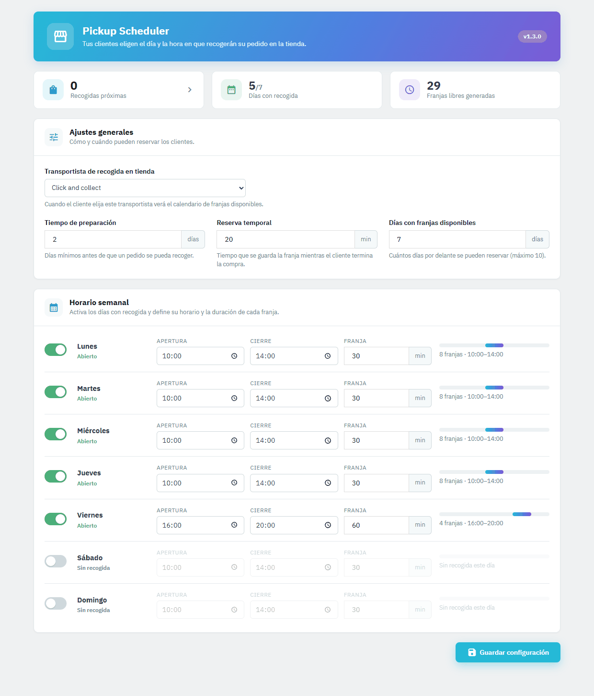

# Pickup Scheduler

[](https://www.prestashop.com/)
[](https://www.php.net/)
[](LICENSE)

PrestaShop module for Click & Collect: at checkout, customers pick the day and time they will collect their order in store. It works on top of the pickup carrier you already have.

## Features

- **Carrier link**: attach the module to an existing pickup carrier (e.g. "Store pickup").
- **Preparation time**: the minimum number of days the store needs before an order can be collected.
- **Slot reservation**: the chosen slot is held while the customer finishes checkout and released if the time runs out.
- **Opening hours per weekday**: enable or disable pickup for each day, with its own hours and slot length.
- **Rolling availability**: slots are generated automatically so the next days (up to 10) are always bookable.
- **PDF invoices**: the pickup date and time can be printed on the order invoice.
- **Confirmation email**: the customer gets an email with the pickup day and time when the order is placed.
- **Back-office list**: all upcoming (or past) pickups in one place, with the order status and a link to each order.
- **Works with the Classic and Hummingbird themes.**

## Installation

1. Download **`pickupscheduler.zip`** from the [latest release](https://github.com/oskratch/prestashop-module-pickupscheduler/releases/latest).
2. In the PrestaShop back office, go to **Modules** → **Module Manager** → **Upload a module**.
3. Upload the zip. The module is installed and enabled, ready to configure.

GitHub's automatic "Source code" zip contains the whole repository and can't be uploaded to PrestaShop directly. If you work from a clone, zip the `pickupscheduler/` folder itself.

To update, upload the new `pickupscheduler.zip` the same way: your settings and bookings are kept.

## Configuration

Go to **Modules** → **Module Manager** → **Pickup Scheduler** → **Configure**. Everything is on one page, with a summary of upcoming pickups, active days and free slots at the top. Confirmed pickups can be reviewed at any time under **Orders** → **Recogidas en tienda**.



| Option | What it does |
|--------|--------------|
| Carrier | The existing pickup carrier the module works with |
| Preparation time | Minimum days before an order can be collected |
| Reservation timeout | How long a slot is held during checkout |
| Weekly schedule | Pickup on/off per weekday, opening hours and slot length (minimum 4 minutes), with a preview of how many slots each day gets |
| Available days window | How many days ahead (up to 10) always have slots ready to book |

The checkout texts and the confirmation email are in Spanish. The email is sent in the order's language if you add a translated template under `mails/<iso>/`.

## PDF invoice

To show the pickup date and time on PDF invoices:

1. Find your theme's `invoice.tpl` (usually `themes/your-theme/pdf/invoice.tpl`).
2. Copy it to your child theme if it isn't there already.
3. Add this line after the shipping information block:

```smarty
{hook h='displayInvoice' id_order=$order->id}
```

Invoices for orders with a scheduled pickup will then include its date and time.

## Support

- Email: [oskratch@gmail.com](mailto:oskratch@gmail.com)
- Bug reports: [GitHub Issues](../../issues)

## License

GPL-2.0. See [LICENSE](LICENSE).
